 

 

  

<table align="center">
<tr>
<td width="100%">

Student of **cybersecurity** and **software development**.

I study how systems are built to understand how they break, and I write code to automate, test and build.

</td>
</tr>
</table>

<code>"Every system has a flaw. Learning to find it is the craft."</code>

 

  

<code>// languages</code>

  
  
  

<code>// web</code>

  
  

<code>// tools</code>

  
  

<code>// operating systems</code>

  
  

 
